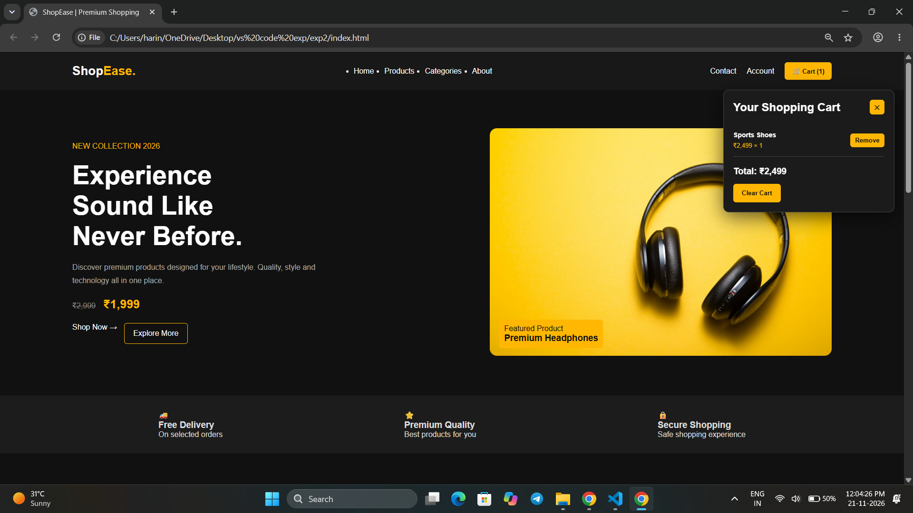
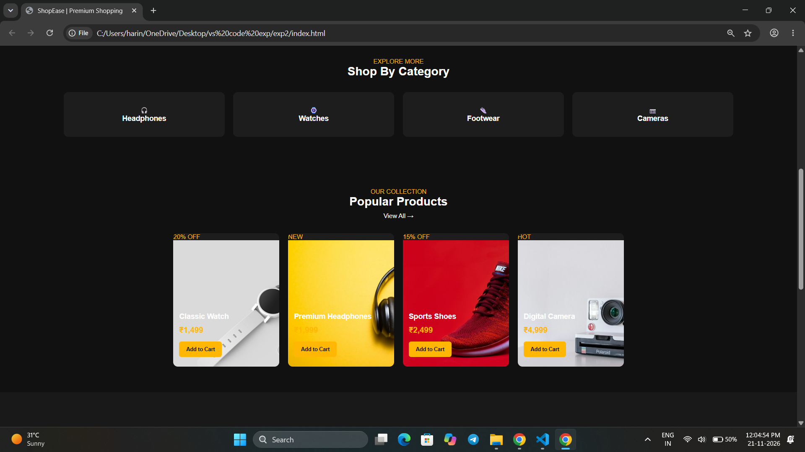
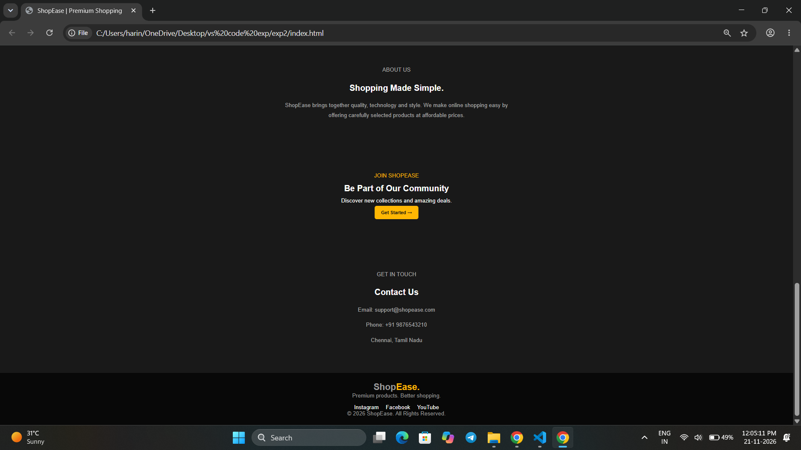

# Ex02 Commercial Website
## Date:21-11-2026

## AIM
To create a commercial website using CSS Flexbox.

## ALGORITHM
### STEP 1
Create an HTML file (index.html)

### STEP 2
Create a CSS file (style.css)

### STEP 3
Include a navigation bar with links to different sections.

### STEP 4
Add structured sections for Homepage, Products / Services, About Us, Contact Details and User Account.

### STEP 5
Include social media links at the footer with copyright information.

### STEP 6
Define global styles for fonts, colors, and layout.

### STEP 7
Style the header, navigation bar, and sections.

### STEP 8
Use Flexbox for layout design.

### STEP 9
Add hover effects and transitions for interactivity.

### STEP 10
Add Images and Media.

### STEP 11
Use optimized images for a professional look.

### STEP 12
Open the HTML file in a browser to check layout and functionality.

### STEP 13
Fix styling issues and refine content placement.

### STEP 14
Deploy the website.

### STEP 15
Upload to GitHub Pages for free hosting.

## PROGRAM

index.html
```

<!DOCTYPE html>
<html lang="en">
<head>
    <meta charset="UTF-8">
    <meta name="viewport" content="width=device-width, initial-scale=1.0">
    <title>ShopEase | Premium Shopping</title>
    <link rel="stylesheet" href="style.css">
</head>
<body>

    <header>
        <nav class="navbar">
            <h2 class="logo">Shop<span>Ease.</span></h2>

            <ul class="nav-links">
                <li><a href="#home">Home</a></li>
                <li><a href="#products">Products</a></li>
                <li><a href="#categories">Categories</a></li>
                <li><a href="#about">About</a></li>
            </ul>

            <div class="nav-right">
                <a href="#contact">Contact</a>
                <a href="#account">Account</a>
                <button class="cart-btn" onclick="toggleCart()">
    🛒 Cart (<span id="cart-count">0</span>)
</button>
            </div>
        </nav>
    </header>
    <div class="cart-panel" id="cart-panel">
    <div class="cart-header">
        <h2>Your Shopping Cart</h2>
        <button class="close-btn" onclick="toggleCart()">✕</button>
    </div>

    <div id="cart-items">
        <p>Your cart is empty.</p>
    </div>

    <div class="cart-footer">
        <h3>Total: ₹<span id="cart-total">0</span></h3>
        <button onclick="clearCart()">Clear Cart</button>
    </div>
</div>

    <main>

        <section class="hero" id="home">

            <div class="hero-content">
                <p class="tag">NEW COLLECTION 2026</p>

                <h1>Experience<br>
                    Sound Like<br>
                    <span>Never Before.</span>
                </h1>

                <p class="hero-description">
                    Discover premium products designed for
                    your lifestyle. Quality, style and technology
                    all in one place.
                </p>

                <div class="hero-price">
                    <span class="old-price">₹2,999</span>
                    <span class="new-price">₹1,999</span>
                </div>

                <div class="hero-buttons">
                    <a href="#products" class="primary-btn">Shop Now →</a>
                    <a href="#about" class="secondary-btn">Explore More</a>
                </div>
            </div>

            <div class="hero-image">
                
                <div class="image-label">
                    <p>Featured Product</p>
                    <h3>Premium Headphones</h3>
                </div>
            </div>

        </section>

        <section class="benefits">
            <div class="benefit">
                <span>🚚</span>
                <div>
                    <h3>Free Delivery</h3>
                    <p>On selected orders</p>
                </div>
            </div>

            <div class="benefit">
                <span>⭐</span>
                <div>
                    <h3>Premium Quality</h3>
                    <p>Best products for you</p>
                </div>
            </div>

            <div class="benefit">
                <span>🔒</span>
                <div>
                    <h3>Secure Shopping</h3>
                    <p>Safe shopping experience</p>
                </div>
            </div>
        </section>

        <section class="categories" id="categories">
            <div class="section-heading">
                <div>
                    <p class="tag">EXPLORE MORE</p>
                    <h2>Shop By Category</h2>
                </div>
            </div>

            <div class="category-container">

                <a href="#products" class="category-card">
                    <span>🎧</span>
                    <h3>Headphones</h3>
                </a>

                <a href="#products" class="category-card">
                    <span>⌚</span>
                    <h3>Watches</h3>
                </a>

                <a href="#products" class="category-card">
                    <span>👟</span>
                    <h3>Footwear</h3>
                </a>

                <a href="#products" class="category-card">
                    <span>📷</span>
                    <h3>Cameras</h3>
                </a>

            </div>
        </section>

        <section class="products" id="products">

            <div class="section-heading">
                <div>
                    <p class="tag">OUR COLLECTION</p>
                    <h2>Popular Products</h2>
                </div>
                <a href="#products" class="view-all">View All →</a>
            </div>

            <div class="product-container">

                <div class="product-card">
                    <div class="product-image">
                        <span class="discount">20% OFF</span>
                        
                    </div>
                    <h3>Classic Watch</h3>
                    <p class="price">₹1,499</p>
                    <button onclick="addToCart('Classic Watch', 1499)">Add to Cart</button>
                </div>

                <div class="product-card">
                    <div class="product-image">
                        <span class="discount">NEW</span>
                        
                    </div>
                    <h3>Premium Headphones</h3>
                    <p class="price">₹1,999</p>
                    <button onclick="addToCart('Premium Headphones', 1999)">Add to Cart</button>
                </div>

                <div class="product-card">
                    <div class="product-image">
                        <span class="discount">15% OFF</span>
                        
                    </div>
                    <h3>Sports Shoes</h3>
                    <p class="price">₹2,499</p>
                    <button onclick="addToCart('Sports Shoes', 2499)">Add to Cart</button>
                </div>

                <div class="product-card">
                    <div class="product-image">
                        <span class="discount">HOT</span>
                        
                    </div>
                    <h3>Digital Camera</h3>
                    <p class="price">₹4,999</p>
                    <button onclick="addToCart('Digital Camera', 4999)">Add to Cart</button>
                </div>

            </div>
        </section>

        <section class="about" id="about">
            <p class="tag">ABOUT US</p>
            <h2>Shopping Made Simple.</h2>
            <p>
                ShopEase brings together quality, technology and
                style. We make online shopping easy by offering
                carefully selected products at affordable prices.
            </p>
        </section>

        <section class="account" id="account">
            <p class="tag">JOIN SHOPEASE</p>
            <h2>Be Part of Our Community</h2>
            <p>Discover new collections and amazing deals.</p>
            <button onclick="alert('Welcome to ShopEase!')">
                Get Started →
            </button>
        </section>

        <section class="contact" id="contact">
            <p class="tag">GET IN TOUCH</p>
            <h2>Contact Us</h2>
            <p>Email: support@shopease.com</p>
            <p>Phone: +91 9876543210</p>
            <p>Chennai, Tamil Nadu</p>
        </section>

    </main>

    <footer>
        <h2 class="logo">Shop<span>Ease.</span></h2>
        <p>Premium products. Better shopping.</p>

        <div class="social-links">
            <a href="https://www.instagram.com/">Instagram</a>
            <a href="https://www.facebook.com/">Facebook</a>
            <a href="https://www.youtube.com/">YouTube</a>
        </div>

        <p>© 2026 ShopEase. All Rights Reserved.</p>
    </footer>

    <script src="script.js"></script>

</body>
</html>
```

style.css
```

* {
    margin: 0;
    padding: 0;
    box-sizing: border-box;
    font-family: Arial, sans-serif;
}

html {
    scroll-behavior: smooth;
}

body {
    background: #111;
    color: white;
}

a {
    color: white;
    text-decoration: none;
}

button {
    border: none;
    cursor: pointer;
    background: #ffb703;
    color: #111;
    padding: 12px 18px;
    border-radius: 6px;
    font-weight: bold;
}

button:hover, .primary-btn:hover {
    background: white;
}

.navbar {
    display: flex;
    justify-content: space-between;
    align-items: center;
    padding: 22px 8%;
    background: #181818;
}

.logo {
    font-size: 26px;
    font-weight: bold;
}

.logo span, .tag, .new-price, .price {
    color: #ffb703;
}

.nav-links, .nav-right {
    display: flex;
    align-items: center;
    gap: 22px;
}

.nav-links a:hover, .nav-right a:hover {
    color: #ffb703;
}

.cart, .cart-btn {
    background: #ffb703;
    color: #111;
    padding: 10px 15px;
    border-radius: 6px;
}

.hero {
    display: flex;
    align-items: center;
    justify-content: space-between;
    gap: 40px;
    padding: 80px 8%;
    min-height: 500px;
}

.hero-content {
    max-width: 520px;
}

.hero h1 {
    font-size: clamp(35px, 5vw, 55px);
    margin: 20px 0;
}

.hero-description {
    color: #aaa;
    line-height: 1.7;
}

.hero-price {
    margin: 22px 0;
}

.old-price {
    color: #888;
    text-decoration: line-through;
    margin-right: 12px;
}

.new-price {
    font-size: 25px;
    font-weight: bold;
}

.hero-buttons {
    display: flex;
    gap: 15px;
    margin-top: 25px;
}

.secondary-btn {
    border: 1px solid #ffb703;
    padding: 12px 18px;
    border-radius: 6px;
}

.hero-image {
    width: 45%;
    position: relative;
}

.hero-image img {
    width: 100%;
    border-radius: 15px;
}

.image-label {
    position: absolute;
    bottom: 20px;
    left: 20px;
    background: #ffb703;
    color: #111;
    padding: 10px;
    border-radius: 5px;
}

.benefits {
    display: flex;
    justify-content: space-around;
    flex-wrap: wrap;
    gap: 20px;
    padding: 30px 8%;
    background: #1c1c1c;
}

.benefit {
    color: #ddd;
}

.categories, .products, .about, .account, .contact {
    padding: 65px 8%;
}

.section-heading {
    text-align: center;
    margin-bottom: 35px;
}

.section-heading h2 {
    font-size: 30px;
    margin-bottom: 10px;
}

.category-container, .product-container {
    display: flex;
    justify-content: center;
    flex-wrap: wrap;
    gap: 22px;
}

.category-card, .product-card {
    background: #1d1d1d;
    border-radius: 12px;
    overflow: hidden;
    transition: .3s;
}

.category-card:hover, .product-card:hover {
    transform: translateY(-6px);
}

.category-card {
    flex: 1 1 200px;
    padding: 35px 15px;
    text-align: center;
}

.product-card {
    flex: 1 1 220px;
    max-width: 270px;
    padding-bottom: 20px;
}

.product-image {
    width: 100%;
    height: 190px;
    object-fit: cover;
}

.product-card h3, .product-card p {
    margin: 12px 15px;
}

.product-card button {
    margin: 5px 15px;
}

.discount {
    color: #ffb703;
}

.price {
    font-size: 20px;
    font-weight: bold;
}

.about, .account, .contact {
    text-align: center;
    background: #191919;
    line-height: 1.8;
}

.about p, .contact p {
    color: #aaa;
    max-width: 650px;
    margin: 15px auto;
}

.social-links {
    display: flex;
    justify-content: center;
    gap: 20px;
    margin-top: 15px;
}

footer {
    text-align: center;
    padding: 25px;
    background: #080808;
    color: #999;
}

/* Shopping cart */

.cart-panel {
    display: none;
    position: fixed;
    top: 80px;
    right: 20px;
    width: 360px;
    max-width: calc(100% - 30px);
    max-height: 75vh;
    overflow-y: auto;
    background: #1b1b1b;
    border: 1px solid #444;
    border-radius: 12px;
    padding: 20px;
    z-index: 200;
    box-shadow: 0 10px 40px #0009;
}

.cart-panel.active {
    display: block;
}

.cart-header, .cart-item {
    display: flex;
    justify-content: space-between;
    align-items: center;
    gap: 10px;
}

.cart-header {
    margin-bottom: 20px;
}

.close-btn, .cart-item button {
    width: auto;
    padding: 7px 10px;
}

.cart-item {
    padding: 15px 0;
    border-bottom: 1px solid #444;
}

.cart-item h4 {
    font-size: 14px;
    margin-bottom: 7px;
}

.cart-item p {
    color: #ffb703;
    font-size: 13px;
}

.cart-footer {
    padding-top: 20px;
}

.cart-footer h3 {
    margin-bottom: 15px;
}

@media (max-width: 768px) {
    .navbar, .hero {
        flex-direction: column;
        text-align: center;
    }

    .nav-links, .nav-right {
        flex-wrap: wrap;
        justify-content: center;
    }

    .hero {
        padding: 50px 6%;
    }

    .hero-image {
        width: 100%;
    }

    .hero-buttons {
        justify-content: center;
    }

    .benefits {
        flex-direction: column;
        align-items: center;
    }
}

```
script.js
```

let cart = JSON.parse(localStorage.getItem("shopCart")) || [];

function saveCart() {
    localStorage.setItem("shopCart", JSON.stringify(cart));
}

function updateCart() {
    let count = 0;
    let total = 0;

    cart.forEach(item => {
        count += item.quantity;
        total += item.price * item.quantity;
    });

    document.getElementById("cart-count").textContent = count;
    document.getElementById("cart-total").textContent = total.toLocaleString("en-IN");

    let items = document.getElementById("cart-items");

    if (cart.length === 0) {
        items.innerHTML = "<p>Your cart is empty.</p>";
    } else {
        items.innerHTML = cart.map((item, index) => `
            <div class="cart-item">
                <div>
                    <h4>${item.name}</h4>
                    <p>₹${item.price.toLocaleString("en-IN")} × ${item.quantity}</p>
                </div>
                <button onclick="removeItem(${index})">Remove</button>
            </div>
        `).join("");
    }

    saveCart();
}

function addToCart(name, price) {
    let item = cart.find(product => product.name === name);

    if (item) {
        item.quantity++;
    } else {
        cart.push({
            name: name,
            price: price,
            quantity: 1
        });
    }

    updateCart();
    alert(name + " added to cart!");
}

function removeItem(index) {
    cart.splice(index, 1);
    updateCart();
}

function clearCart() {
    cart = [];
    updateCart();
}

function toggleCart() {
    document.getElementById("cart-panel").classList.toggle("active");
}

updateCart();
```


## OUTPUT








## RESULT
The program for creating commercial website using CSS Flexbox is executed successfully.
